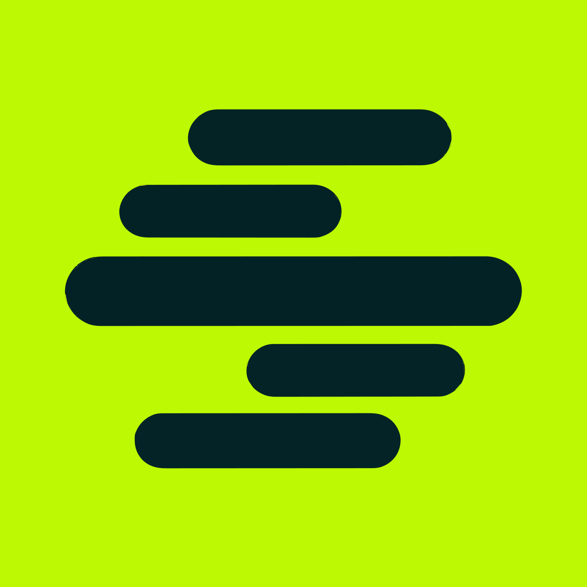
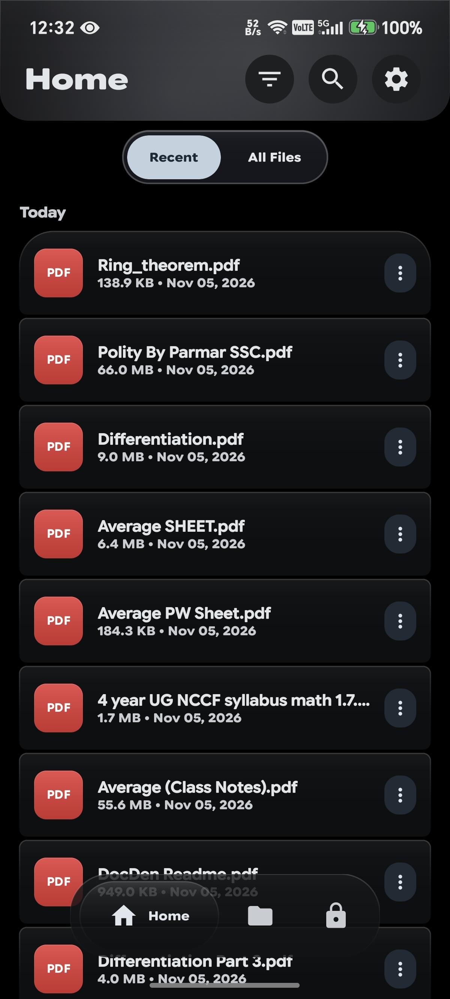
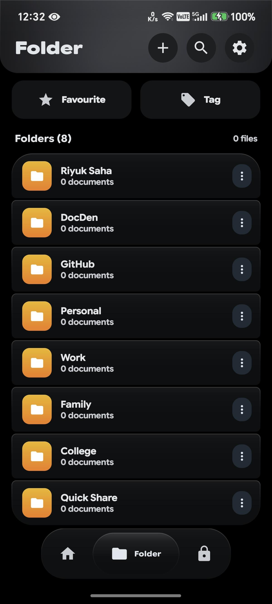
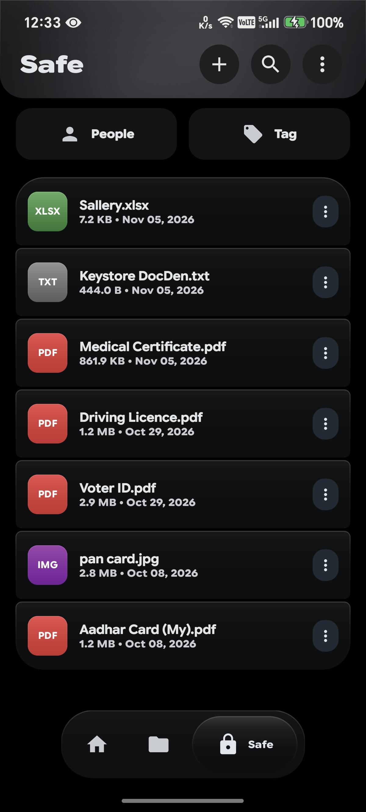
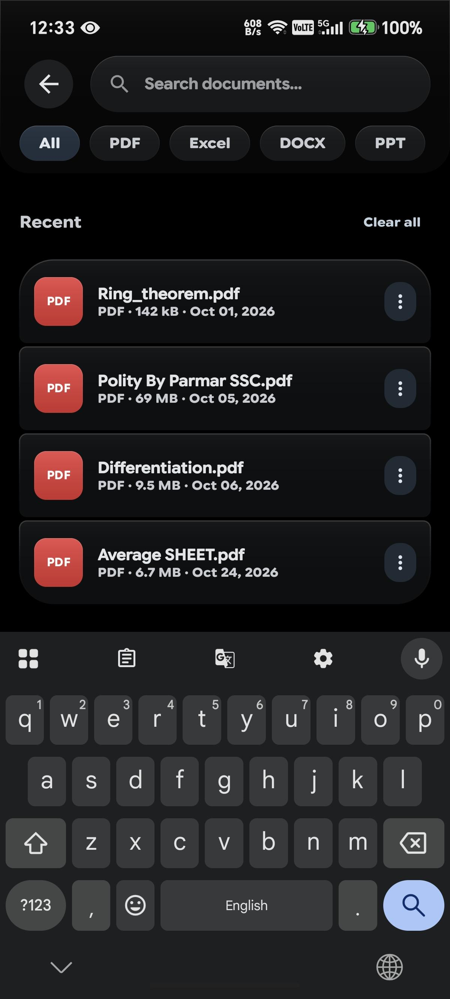
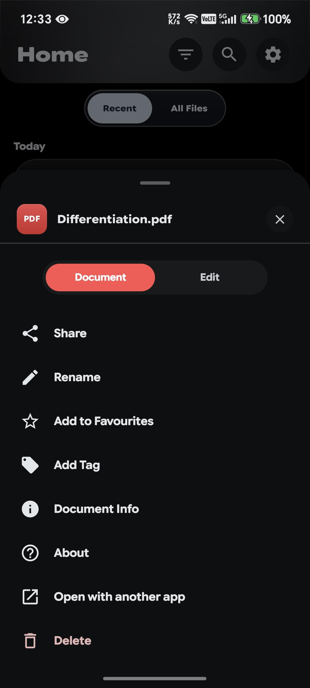
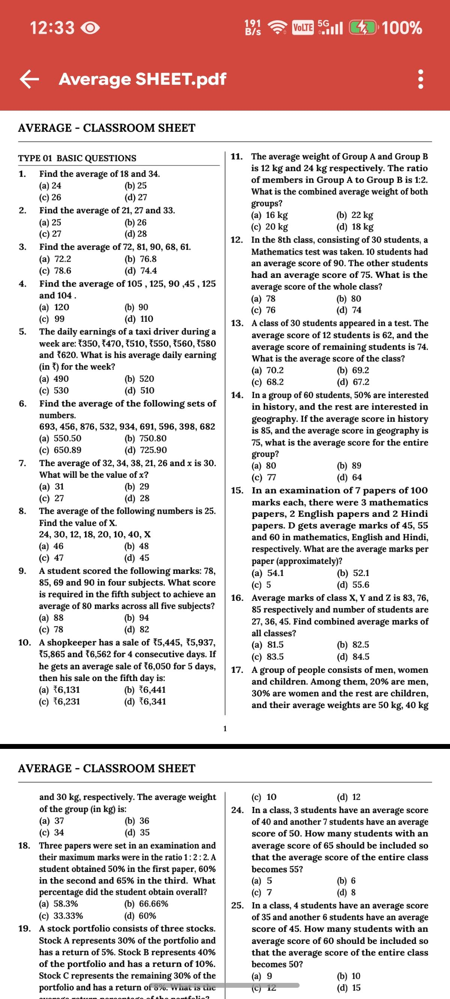
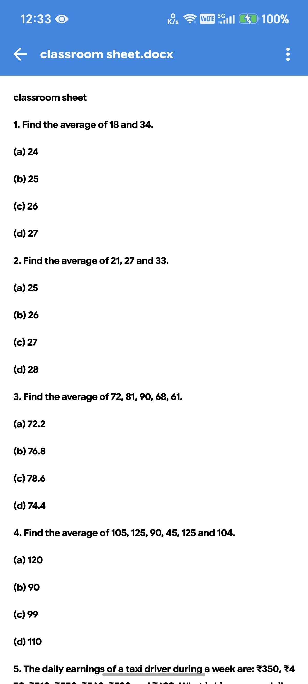
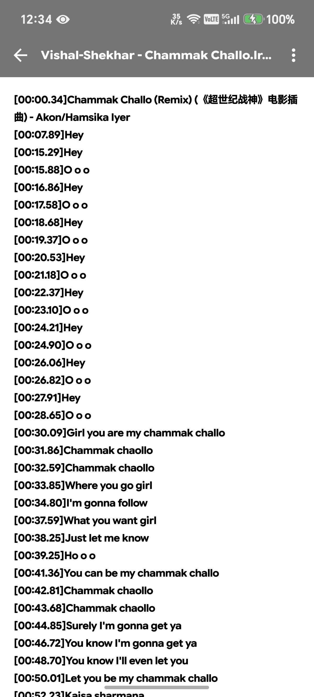

# DocDen

**The Secure, Encrypted, 100% Offline Document Vault & Manager for Android.**  
*Built with modern Kotlin, Jetpack Compose, and Material 3 Expressive design.*

  
  
  
  
  

  <a href="#-app-screenshots">Screenshots</a> •
  <a href="#-key-features">Features</a> •
  <a href="#-download-packages">Downloads</a> •
  <a href="#-security--privacy-architecture">Security</a> •
  <a href="#-legal--policies">Legal & Policies</a>

---

## 🌟 Overview

**DocDen** is an ultra-secure, privacy-first personal document vault engineered for users who value absolute sovereignty over their data. Unlike conventional cloud document services that expose your private IDs, medical files, tax receipts, and contracts to remote data breaches, **DocDen operates strictly 100% offline**.

All documents, tags, person associations, and metadata are encrypted directly on your device hardware using **AES-256 GCM**. Protected by an effortless **Biometric App Lock** (Fingerprint & Face Unlock) and wrapped in a stunning **Material 3 Expressive** interface, DocDen makes private document management smooth, reliable, and aesthetically delightful.

---

## 📱 App Screenshots

  
  
  
  
  
  
  
  

---

## ✨ Key Features

### 🛡️ Local AES-256 GCM Encrypted Vault
- **Zero-Knowledge Architecture:** Encrypt sensitive documents, IDs, passport copies, financial records, and private notes directly inside your device's isolated storage sandbox.
- **Hardware-Backed Key Derivation:** Cryptographic keys are bound to your device using Android's hardware security layer.

### 🔒 Native Hardware Biometric App Lock
- **Fingerprint & Face Unlock:** Direct integration with Android's native `BiometricPrompt` framework.
- **Privacy Preserving:** Zero biometric data is ever viewed or stored by DocDen; all checks occur within the Android operating system Trusted Execution Environment (TEE).
- **Instant Background Timeout:** Automatically locks the vault the moment you switch apps or lock your screen.

### 📄 Universal Document & File Viewer
- **Multi-Format Rendering:** Built-in high-performance viewer for **PDFs**, Microsoft Word (**`.docx`**), Microsoft Excel (**`.xlsx`**), text files, and high-resolution images.
- **Theme Adaptability:** Automatic day and night mode switching for document reading without eye strain.

### 👥 People & Smart Tag Organization
- **People Tagging:** Attach documents to family members, clients, or doctors with profile photos, date of birth, age calculation, and contact notes.
- **Color-Coded Tags:** Organize files with customizable tag color palettes and nested folders for effortless document discovery.
- **Instant Offline Search:** Filter and search across thousands of files, file extensions, people, and tags in milliseconds.

### 💾 Encrypted Portable Backups (`.docden`)
- **One-Click Backup & Restore:** Export your entire vault, documents, relationships, and metadata into a single AES-256 encrypted `.docden` archive file.
- **Offline Data Migration:** Easily restore your complete vault to a new device without relying on internet connectivity.

### 🎨 Material 3 Expressive Theming
- **Dynamic Accent Colors:** Choose from preset palettes or pick your own custom accent hue.
- **AMOLED True-Black Mode:** Completely deep pitch-black backgrounds tailored for battery efficiency on OLED displays.
- **Fluid Gestures:** Expressive bottom sheets, spring animations, and edge-to-edge system bar integration.

---

## 📦 Download Packages

We provide pre-compiled, optimized APKs built via our automated CI/CD workflow. Check the [Releases](../../releases) tab to download.

| Package | Supported OS | Architecture | Highlights |
| :--- | :--- | :--- | :--- |
| **`DocDen-V1.0.0-Riyuk.apk`** | **Android 7.0+ (API 24–37)** | Universal (`arm64-v8a`, `armeabi-v7a`, `x86_64`) | **Standard Recommended Release.** R8-optimized with page-aligned uncompressed native libraries. |

---

## 🔐 Security & Privacy Architecture

